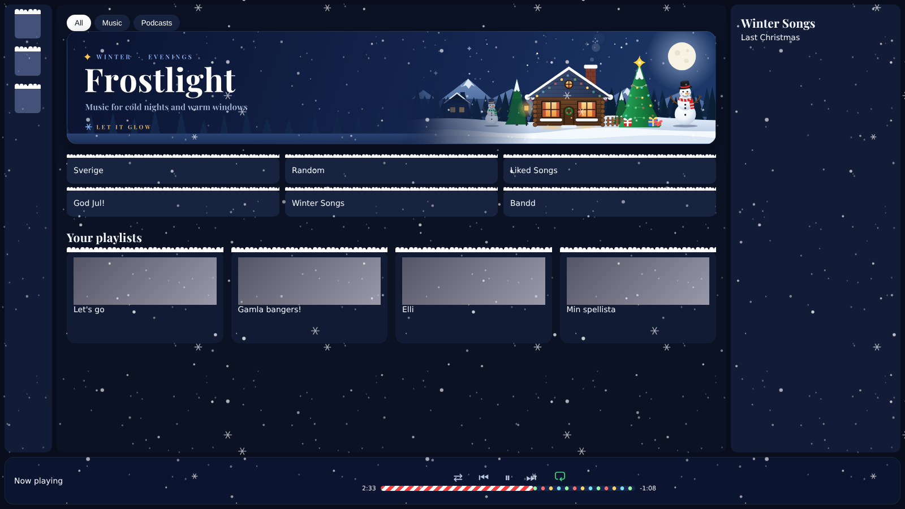

# Frostlight

A cozy winter-night theme for [Spicetify](https://spicetify.app).

- Animated snowfall (three layers, GPU-friendly, no JavaScript)
- A glowing cabin scene with trees, snowmen and presents on the Home page
- Snow piled on top of playlist cards, Home tiles and sidebar icons
- Smooth candy-cane song progress bar, and a string of Christmas lights as the volume bar
- Icicles, a Santa hat on the cover art and a snowflake cursor
- Candy-cane scrollbar, holly on cards, pine garland on the player bar, red bauble play button
- Christmas font for titles (Mountains of Christmas, bundled in the CSS)
- Two colour schemes: `frost` (night blue and gold) and `ember` (forest green and red)



## Install

### Spicetify Marketplace
Open the Marketplace tab in Spotify, search for **Frostlight** and click Install.

### Manual
Copy `user.css` and `color.ini` into a folder called `Frostlight` inside Spicetify's `Themes` folder, then:

```
spicetify config current_theme Frostlight color_scheme frost
spicetify config inject_css 1 replace_colors 1 overwrite_assets 0
spicetify apply
```

## Colour schemes

```
spicetify config color_scheme ember
spicetify apply
```

## Lighter / no snow

The snowfall is one clearly marked block at the bottom of `user.css`
(`SNOWFALL` ... `END SNOWFALL`). Delete it and run `spicetify apply` to turn the snow off.
The CSS also stops all animation if your system has "reduce motion" enabled.

## Troubleshooting

- Theme not applied: run `spicetify backup apply` again (Spotify updates remove it).
- Banner or snow caps missing after a Spotify update: [open an issue](https://github.com/flasnutt/FrostlightV2/issues) with a screenshot.

## Notes

- The Home banner uses `:has()` and Spotify's internal class names, which can change after a Spotify update.
  If the banner or snow caps disappear, please open an issue.
- Fonts: Mountains of Christmas, Apache License 2.0 (see `APACHE-MountainsOfChristmas.txt`); Playfair Display, SIL Open Font License 1.1 (see `OFL-PlayfairDisplay.txt`).

## License

MIT, see `LICENSE`.
